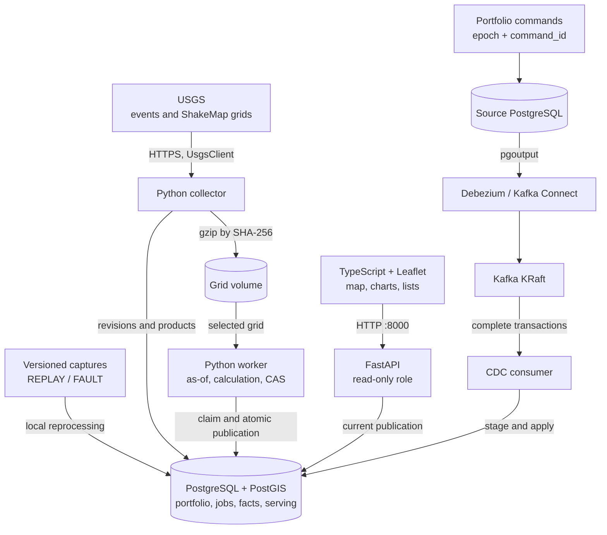

<div align="center">
  
</div>

# QuakeExposure

Asset exposure triage using real USGS earthquakes and a fictional portfolio. I built the collector, geographic calculations, portfolio updates through CDC, and dashboard for inspecting classified assets and following revisions.

<p>
  <a href="#demo"></a>
  <a href="#architecture"></a>
  <a href="#run-locally"></a>
  <a href="#verification"></a>
  <a href="https://www.linkedin.com/in/arthur-joanes-6a2967373/"></a>
</p>

[Português](README.md)

[](https://github.com/arthurjoanes/quake-exposure/actions/workflows/ci.yaml)

## Overview

An earthquake revision or portfolio correction can change which assets enter the result. QuakeExposure calculates exposure using the portfolio version effective at the event time and known at the selected revision. Each publication fixes the event, ShakeMap, portfolio version, and rule; the map, charts, and lists read that same result.

The initial load creates 10,000 assets across two portfolios, with BRL and USD values. REPLAY uses real USGS captures; FAULT labels test mutations; LIVE follows live collection. The dashboard offers two criteria:

| Criterion | Calculation | Reading the result |
| --- | --- | --- |
| 100 km radius | `ST_DWithin` on geography, measured from the epicenter | Assets near the event |
| MMI intensity ≥ 6.0 | ShakeMap grid sampled at each asset location | Assets within the grid extent and above the threshold |

The criteria select assets for inspection. Amounts represent the classified portfolio; they do not estimate damage, financial losses, or future earthquakes.

## Demo


<details>
<summary>View charts, asset lists and mobile layout</summary>


[Charts on mobile](docs/results/ui-mobile-charts.png)

</details>

Local captures from October 9, 2026, using REPLAY data and a fictional portfolio. The demo changes the portfolio and erases one asset; the Operadora B screenshot therefore shows 4,999 assets after an initial load of 5,000 in that portfolio.

In the [run recorded on October 9, 2026](docs/results/verify-demo.json), event `us7000tiur`, portfolio Operadora B, and criterion MMI ≥ 6.0 produced:

| Result | Value |
| --- | --- |
| Eligible assets within the grid extent | 1,972 |
| Assets classified by the intensity threshold | 45 |
| Classified amount in BRL | BRL 864,346.66 |
| Classified amount in USD | USD 5,147,876.70 |

To inspect this scenario in the dashboard:

1. Select REPLAY, Operadora B, `us7000tiur`, and the MMI criterion. Inspect portfolio composition, amounts by currency, and intensity distribution in the charts.
2. Filter the asset list by classified status and currency. Search for an ID or locate an asset on the map. Pages contain 50 or 100 rows; list filters do not change chart totals.
3. Inspect revisions and entries and exits between publications. Scope, portfolio, event, and criterion are stored in the URL.

The map uses OpenStreetMap streets and places, with point clustering at lower zoom levels. The offline alternative includes Natural Earth countries and coastlines at 1:50 million scale. Online tiles require internet access; portfolio data comes from the local API. A missing ShakeMap appears as unavailable, without assigning zero intensity to assets. The application interface is in Brazilian Portuguese.

## Architecture



All [Compose](compose.yaml) services run on the same host. The API serves the page and reads the current publication; the browser does not access databases or Kafka. Live collection is optional for the captured-data demo.

| Responsibility | Implementation and decision |
| --- | --- |
| Revisions and identity | [Domain](src/quakeexposure/domain/) and [ingestion](src/quakeexposure/ingestion/): canonical hashes, current aliases, idempotent duplicates, and quarantined conflicts. |
| Historical portfolio | [Source](src/quakeexposure/portfolio/source.py) and [CDC](src/quakeexposure/cdc/): idempotent commands, a tenant epoch, and complete-transaction application. [ADR](docs/adr/0002-kafka-na-carteira.md). |
| Consistent publication | [Worker](src/quakeexposure/exposure/worker.py): facts, totals, and the current pointer commit together; stale generations cannot publish. [ADR](docs/adr/0003-calculo-e-cas.md). |
| Erasure and restore | [Privacy](src/quakeexposure/privacy/): ledger in a separate volume, old CDC sanitization, and current blocks reapplied during restore. [ADR](docs/adr/0004-exclusao-contra-replay.md). |
| Visualization | [Frontend](web/src/): stale selection responses are discarded; charts validate publication identity; money remains integer until formatting. |

## Stack and decisions

<p>
  
  
  
  
  
  
  
</p>

| Component | Role and tradeoff |
| --- | --- |
| Python 3.14, uv, FastAPI | Domain, collection, calculation, and API; separate processes share the codebase. |
| PostgreSQL + PostGIS | History, geographic calculations, and transactional publication share the database. |
| Debezium and Kafka | Portfolio change transport; requires managing the replication slot, offsets, and staging. |
| TypeScript, Vite, Leaflet | Canvas rendering, point clustering, and SVG charts; no additional chart library. |
| Docker Compose | Local environment with named volumes; every service depends on the same host. |

Versions are pinned in [uv.lock](uv.lock), [package-lock.json](web/package-lock.json), and [Compose](compose.yaml). Decisions are in [docs/adr](docs/adr/), in Portuguese.

## Run locally

Requires Docker Desktop/Compose and uv. Node.js is needed to develop the frontend outside the Docker build. uv installs the pinned Python 3.14 runtime. On Windows, use `python -m uv` if uv is missing from PATH.

```bash
uv sync --frozen
uv run qe secrets
docker compose up -d --build cdc
docker compose run --rm --no-deps worker qe bootstrap
docker compose up -d worker api
```

Open [127.0.0.1:8000](http://127.0.0.1:8000). The initial selection uses REPLAY and event `us7000tiur`. Bootstrap waits for CDC, seeds the portfolio through the source, and imports versioned captures without calling USGS. Completed bootstrap can be resumed; a partial seed requires the [manual reset in the runbook](docs/operacao.md#slot-perdido-ou-offsets-expirados).

```bash
docker compose exec worker qe demo
docker compose exec worker qe status --json
```

The demo covers five steps: real replay, a FAULT revision and duplicate, a portfolio correction through CDC, rejection of a stale calculation, and erasure followed by old CDC redelivery. Each run changes the fictional portfolio and erases one asset.

The [operations guide](docs/operacao.md), in Portuguese, contains commands for live collection, portfolio corrections, erasure, backup, and restore. It also explains how to record the demo with its commit and assertions. Optional grids from networks other than `us` are downloaded separately with hash checks.

## Verification

| Record | Result and scope |
| --- | --- |
| [Five-step demo](docs/results/verify-demo.json) | Eight assertions on October 9, 2026, including duplicates, as-of CDC, stale-generation rejection, and redelivery after erasure. |
| [Restore](docs/results/restore-verification.json) | Ledger reapplied, erased subject absent, and API-role access denied on the restored database. |
| [Empty-volume bootstrap](docs/results/m6-bootstrap-cold.md) | 356.907 s to the four main publications, with cached images and concurrent load documented in the record. |
| [Tests and checks](docs/progress.md) | M6 completion: 307 Python tests with no skips. Frontend update: 80 frontend tests, typecheck, and build. |
| [CI on October 9, 2026](https://github.com/arthurjoanes/quake-exposure/actions/runs/38004551496) | Five jobs completed at commit `7564a7c`: Python, frontend, PostGIS, integration, and security. |

To repeat the checks:

```bash
uv run ruff check .
uv run ruff format --check .
uv run mypy
uv run pytest
cd web
npm ci
npm test
npm run typecheck
npm run build
```

Tests only use local networking. Integration tests start real databases, Kafka, and Debezium in disposable projects; they are skipped when Docker is unavailable. The [workflow](.github/workflows/ci.yaml) includes unit/property/contract tests, a PostGIS service job, full integration, frontend checks, gitleaks, pip-audit, and npm audit. Records above describe identified runs; the badge shows the current workflow status. Bootstrap timing is a local measurement with cached images, excluding downloads and builds.

<a id="limitations"></a>

## Limits and security

- Fictional portfolio; BRL and USD are never converted or combined. Money uses integers and JSON strings. Do not add the same portfolio across earthquakes.
- Polling captures observed USGS revisions, not every intermediate revision.
- LIVE calculates recent ShakeMap events from the last seven days and watchlisted events. REPLAY and FAULT remain separate and labelled.
- Read-only API without authentication; tenant is a filter. Only port 8000 is published, on 127.0.0.1. No TLS between containers.
- Lost slots, expired offsets, and partial seeds require manual reset. No high availability.
- Kafka messages may remain for seven days. WAL and dump residuals are listed in the erasure receipt. Restore reapplies the current ledger, stored outside database volumes.
- Erasure invalidates the tenant's publications until recalculation. Old CDC cannot return blocked subjects to calculations.

## Documentation

| Reference | Link |
| --- | --- |
| Setup, operation, and recovery | [Runbook](docs/operacao.md) |
| Implementation decisions | [ADRs](docs/adr/) · [Repository rules](CONTRIBUTING.md) |
| Runs and measurements | [Results](docs/results/) · [Milestone progress](docs/progress.md) |
| Visual identity | [Symbol](web/public/brand/quake-exposure-mark.svg) · [Wordmark](web/public/brand/wordmark.svg) · [Banner](docs/assets/banner.svg) |
| Presentation maintenance | [Documentation style](docs/padrao-documentacao.md) · [Icon sources and license](docs/stack/README.md) |

<a id="author-data-and-license"></a>

## Author and license

<p><a href="https://www.linkedin.com/in/arthur-joanes-6a2967373/"> <strong>Arthur Joanes on LinkedIn</strong></a></p>

[GitHub](https://github.com/arthurjoanes) · [Report an issue](https://github.com/arthurjoanes/quake-exposure/issues).

Code and original brand assets under [MIT](LICENSE). U.S. Geological Survey public-domain data; ComCat DOI 10.5066/F7MS3QZH. Online map © OpenStreetMap contributors; offline Natural Earth basemap via world-atlas. Sources and credits in [NOTICE](NOTICE).

Stack and LinkedIn icons: [Devicon, MIT license](docs/stack/LICENSE.devicon).
