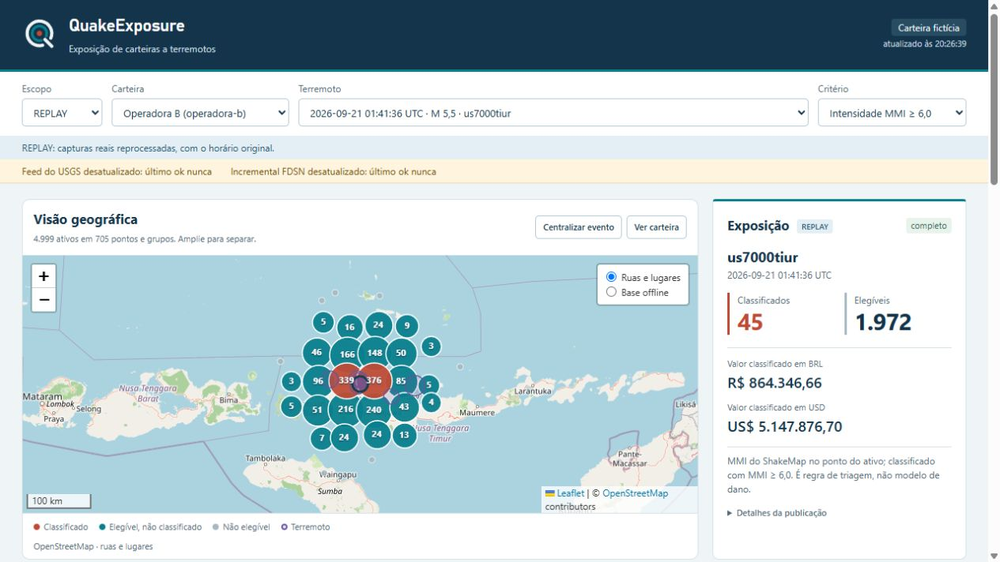
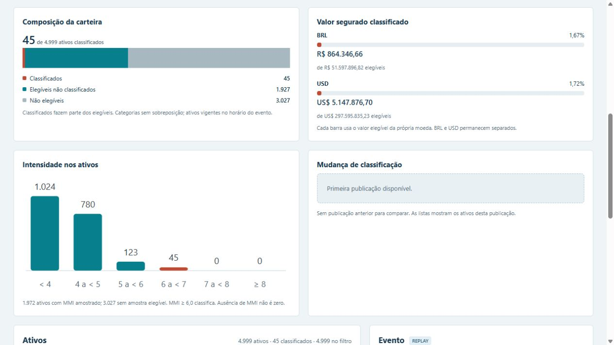
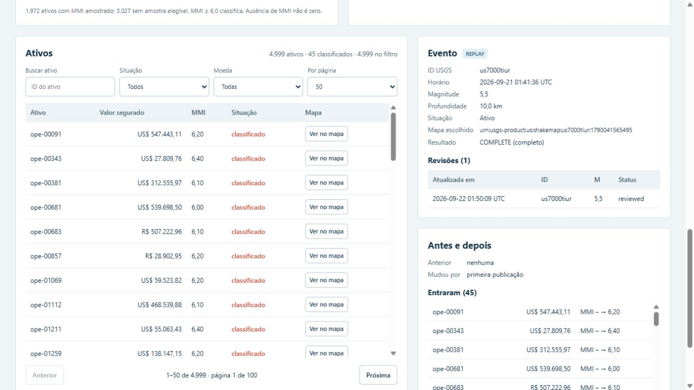
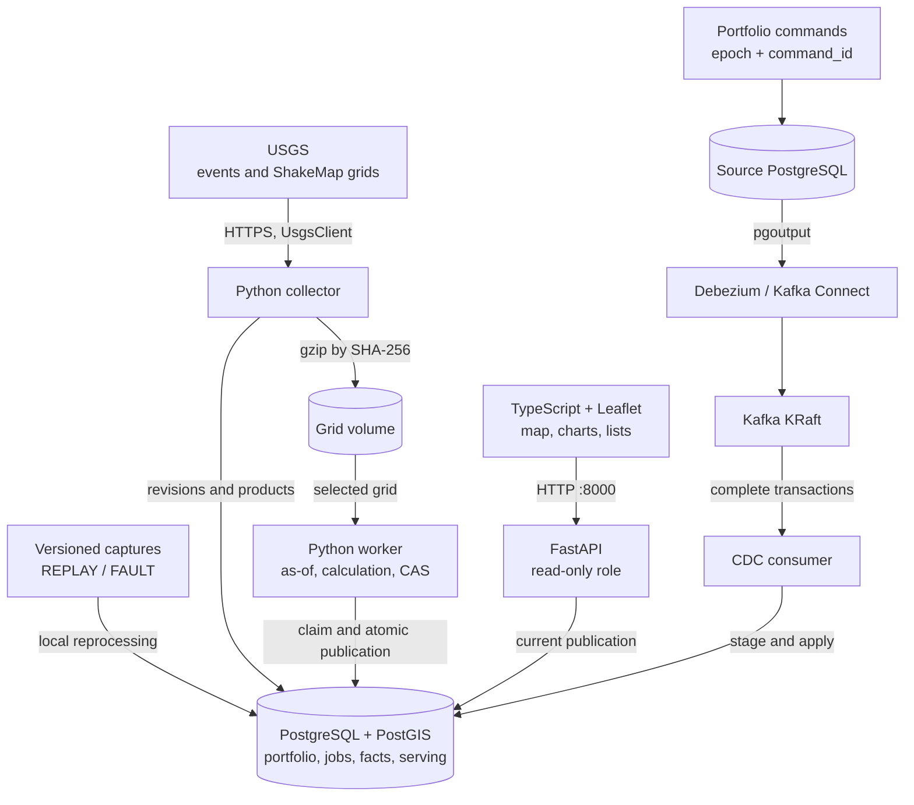

<div align="center">
  
</div>

# QuakeExposure

Real USGS earthquakes, a fictional portfolio, and the path from each change to its published result. The dashboard combines a map, amounts by currency, intensity distribution, and asset lists. The backend handles event revisions, portfolio CDC, and erasure that survives redelivery of old data.

[Português](README.md) · [Demo](#demo) · [Architecture](#architecture) · [Run locally](#run-locally) · [Verification](#verification) · [LinkedIn](https://www.linkedin.com/in/arthur-joanes-6a2967373/)

[](https://github.com/arthurjoanes/quake-exposure/actions/workflows/ci.yaml)

## Overview

The seed creates 10,000 assets across two portfolios, with BRL and USD values. Earthquakes and grids are real captures; test mutations belong to the FAULT scope. Each publication fixes the event, ShakeMap, portfolio version, and rule. Map, charts, and lists read that same publication.

RADIUS_TRIAGE uses a distance of up to 100 km. SHAKEMAP_MMI samples the grid at each asset and classifies MMI ≥ 6.0. These are project triage rules, not earthquake predictions, alerts, damage estimates, or losses. USGS already provides ShakeMap and ShakeCast.

## Demo



<details>
<summary>View charts, asset lists and mobile layout</summary>





[Charts on mobile](docs/results/ui-mobile-charts.png)

</details>

Capture of the local application with REPLAY data and a fictional portfolio. Running the demo can change counts and erase one asset; the initial seed contains 10,000. The [demo recorded on October 9, 2026](docs/results/verify-demo.json) includes its commit, capture hashes, and eight assertions across five steps.

- OpenStreetMap streets and places, clusters at lower zoom levels, and a cache per publication. Events and assets use Canvas; panning does not rebuild every marker. The offline Natural Earth basemap includes countries and coastlines at 1:50 million scale.
- Charts show portfolio composition, classified amounts by currency, MMI distribution, and entries/exits between publications. Missing maps are shown as unavailable. BRL and USD keep separate totals and percentages.
- Asset, revision, and change lists are preserved. Assets support ID search, status and currency filters, 50- or 100-row pages, and an action to locate each asset on the map.
- Scope, portfolio, event, and criterion are recorded in the URL. LIVE, REPLAY, and FAULT remain labelled on screen.

Online tiles require internet access. The offline basemap is included in the build and can be selected on the map. Portfolio data continues to come from the local API. The application interface is in Brazilian Portuguese.

## Architecture



All [Compose](compose.yaml) services run on the same host. The API serves the page and reads the current publication; the browser does not access databases or Kafka. Live collection is optional for the captured-data demo.

| Responsibility | Implementation and decision |
| --- | --- |
| Revisions and identity | [Domain](src/quakeexposure/domain/) and [ingestion](src/quakeexposure/ingestion/): canonical hashes, current aliases, idempotent duplicates, and quarantined conflicts. |
| Historical portfolio | [Source](src/quakeexposure/portfolio/source.py) and [CDC](src/quakeexposure/cdc/): idempotent commands, a tenant epoch, and complete-transaction application. [ADR](docs/adr/0002-kafka-na-carteira.md). |
| Consistent publication | [Worker](src/quakeexposure/exposure/worker.py): facts, totals, and the current pointer commit together; stale generations cannot publish. [ADR](docs/adr/0003-calculo-e-cas.md). |
| Erasure and restore | [Privacy](src/quakeexposure/privacy/): ledger in a separate volume, old CDC sanitization, and current blocks reapplied during restore. [ADR](docs/adr/0004-exclusao-contra-replay.md). |
| Visualization | [Frontend](web/src/): stale selection responses are discarded; charts validate publication identity; money remains integer until formatting. |

## Stack and decisions

| Component | Role and tradeoff |
| --- | --- |
| Python 3.14, uv, FastAPI | Domain, collection, calculation, and API; separate processes share the codebase. |
| PostgreSQL + PostGIS | History, geographic calculations, and transactional publication share the database. |
| Debezium and Kafka | Portfolio change transport; requires managing the replication slot, offsets, and staging. |
| TypeScript, Vite, Leaflet | Canvas rendering, point clustering, and SVG charts; no additional chart library. |
| Docker Compose | Local environment with named volumes; every service depends on the same host. |

Versions are pinned in [uv.lock](uv.lock), [package-lock.json](web/package-lock.json), and [Compose](compose.yaml). Decisions are in [docs/adr](docs/adr/), in Portuguese.

## Run locally

Requires Docker Desktop/Compose and uv. Node.js is needed to develop the frontend outside the Docker build. uv installs the pinned Python 3.14 runtime. On Windows, use `python -m uv` if uv is missing from PATH.

```bash
uv sync --frozen
uv run qe secrets
docker compose up -d --build cdc
docker compose run --rm --no-deps worker qe bootstrap
docker compose up -d worker api
```

Bootstrap waits for the replication slot, seeds the source through commands, waits for CDC, and imports captured USGS data as REPLAY. It makes no USGS requests. Completed bootstrap can be resumed; a partial seed requires manual reset. Keep older directly loaded portfolios in a separate Compose project.

Open [127.0.0.1:8000](http://127.0.0.1:8000). The initial selection uses REPLAY and `us7000tiur`. The read-only API has no authentication; tenant is a filter. Only port 8000 is published, on loopback.

The development instance created for this delivery uses `docker compose -p quake-exposure-v03`. The v0.1 volumes were preserved.

```bash
docker compose exec worker qe demo
docker compose exec worker qe status --json
docker compose exec worker qe explain us7000tiur --tenant seguradora-a --mode SHAKEMAP_MMI --scope REPLAY
docker compose exec worker qe portfolio correct --tenant seguradora-a --interval "seg-00001#1" --lon 120.5 --lat -8.2
docker compose exec worker qe erase <subject_token>
docker compose run --rm maintenance qe backup
docker compose run --rm maintenance qe restore-verify /data/backups/<backup>
```

The five-step demo replays real captures, applies a labelled FAULT revision and duplicate, corrects the portfolio through CDC with an as-of comparison, rejects an outdated calculation, and erases one subject before replaying old CDC. Each run changes the fictional portfolio and erases one asset.

Run `qe verify-demo --commit <git-rev-parse-HEAD> --output /data/backups/verify-demo.json` in the worker to record assertions. Copy the result into `docs/results/` with `docker compose cp worker:/data/backups/verify-demo.json docs/results/verify-demo.json`.

Live collection is explicit:

```bash
docker compose up -d collector
docker compose exec collector qe backfill --from 2026-10-01 --to 2026-10-07
docker compose exec worker qe watch add us7000tiur
```

Grids from contributing networks other than `us` are excluded from Git. `uv run python scripts/fetch_fixtures.py pull` downloads them through the collection client and checks their hashes. They are optional for the main demo.

## Verification

| Local record | Result and scope |
| --- | --- |
| [Five-step demo](docs/results/verify-demo.json) | Eight assertions on October 9, 2026, including duplicates, as-of CDC, stale-generation rejection, and redelivery after erasure. |
| [Restore](docs/results/restore-verification.json) | Ledger reapplied, erased subject absent, and API-role access denied on the restored database. |
| [Empty-volume bootstrap](docs/results/m6-bootstrap-cold.md) | 356.907 s to the four main publications, with cached images and concurrent load documented in the record. |
| [Tests and checks](docs/progress.md) | M6 completion: 307 Python tests with no skips. Frontend update: 80 frontend tests, typecheck, and build. |

To repeat the checks:

```bash
uv run ruff check .
uv run ruff format --check .
uv run mypy
uv run pytest
cd web
npm ci
npm test
npm run typecheck
npm run build
```

Tests only use local networking. Integration tests start real databases, Kafka, and Debezium in disposable projects; they are skipped when Docker is unavailable. The [workflow](.github/workflows/ci.yaml) includes unit/property/contract tests, a PostGIS service job, full integration, frontend checks, gitleaks, pip-audit, and npm audit. Results above come from local runs; remote status is shown by the CI badge.

## Limitations

- Fictional portfolio; BRL and USD are never converted or combined. Money uses integers and JSON strings. Do not add the same portfolio across earthquakes.
- Polling captures observed USGS revisions, not every intermediate revision.
- LIVE calculates recent ShakeMap events from the last seven days and watchlisted events. REPLAY and FAULT remain separate and labelled.
- No authentication or TLS between containers. Intended for local use on 127.0.0.1.
- Lost slots, expired offsets, and partial seeds require manual reset. No high availability.
- Kafka messages may remain for seven days. WAL and dump residuals are listed in the erasure receipt. Restore reapplies the current ledger, stored outside database volumes.
- Erasure invalidates the tenant's publications until recalculation. Old CDC cannot return blocked subjects to calculations.

## Documentation

| Reference | Link |
| --- | --- |
| Setup, operation, and recovery | [Runbook](docs/operacao.md) |
| Implementation decisions | [ADRs](docs/adr/) · [Repository rules](CONTRIBUTING.md) |
| Runs and measurements | [Results](docs/results/) · [Milestone progress](docs/progress.md) |
| Visual identity | [Symbol](web/public/brand/quake-exposure-mark.svg) · [Wordmark](web/public/brand/wordmark.svg) · [Banner](docs/assets/banner.svg) |

## Author, data, and license

Arthur Joanes · [GitHub](https://github.com/arthurjoanes) · [LinkedIn](https://www.linkedin.com/in/arthur-joanes-6a2967373/).

Code and original brand assets under [MIT](LICENSE). U.S. Geological Survey public-domain data; ComCat DOI 10.5066/F7MS3QZH. Online map © OpenStreetMap contributors; offline Natural Earth basemap via world-atlas. Sources and credits in [NOTICE](NOTICE).
