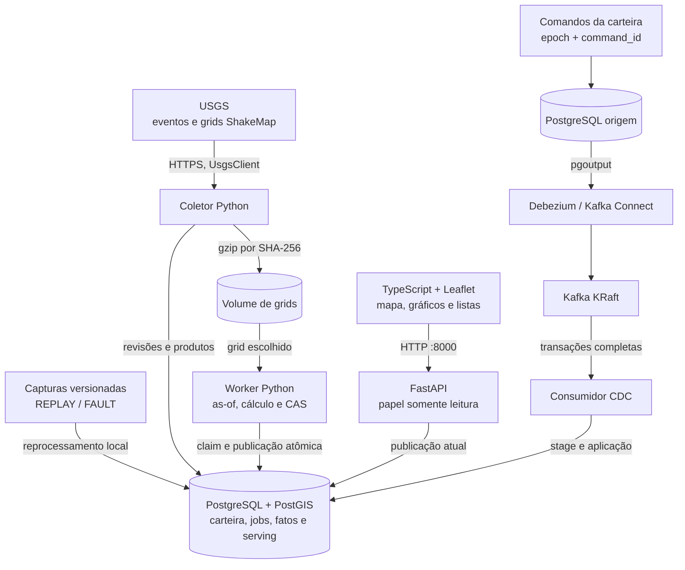

<div align="center">
  
</div>

# QuakeExposure

Terremotos reais do USGS, uma carteira fictícia e o caminho de cada mudança até o resultado publicado. O painel reúne mapa, valores por moeda, distribuição de intensidade e listas de ativos. O backend trata revisões, CDC da carteira e exclusão de titular contra reentrega de dados antigos.

[English](README.en.md) · [Demonstração](#demonstração) · [Arquitetura](#arquitetura) · [Executar localmente](#executar-localmente) · [Verificação](#verificação) · [LinkedIn](https://www.linkedin.com/in/arthur-joanes-6a2967373/)

[](https://github.com/arthurjoanes/quake-exposure/actions/workflows/ci.yaml)

## Visão geral

O seed gera 10.000 ativos em duas carteiras, com valores em BRL e USD. Os terremotos e grids são capturas reais; mudanças de teste ficam no escopo FAULT. Cada publicação fixa evento, ShakeMap, versão da carteira e regra. Mapa, gráficos e listas leem essa mesma publicação.

| Critério | Cálculo | Leitura do resultado |
| --- | --- | --- |
| Raio de 100 km | `ST_DWithin` em geography, a partir do epicentro | Ativos próximos do evento |
| Intensidade MMI ≥ 6,0 | Amostragem do grid ShakeMap no ponto de cada ativo | Ativos dentro da extensão do grid e acima do limiar |

São critérios de triagem. Não estimam dano, perda financeira ou terremotos futuros. O USGS já oferece ShakeMap e ShakeCast.

## Demonstração


<details>
<summary>Ver gráficos, listas e versão para celular</summary>


[Gráficos no celular](docs/results/ui-mobile-charts.png)

</details>

Captura da aplicação local com dados REPLAY e carteira fictícia. A execução da demo pode alterar contagens e excluir um ativo; o seed inicial tem 10.000. A [demo registrada em 09/10/2026](docs/results/verify-demo.json) contém commit, hashes das capturas e oito asserções dos cinco passos.

- Mapa com ruas e localidades do OpenStreetMap, agrupamento ao afastar o zoom e cache por publicação. Eventos e ativos usam Canvas; mover o mapa não reconstrói todos os marcadores. A base offline Natural Earth inclui países e costa na escala 1:50 milhões.
- Gráficos de composição dos ativos, valores classificados por moeda, distribuição MMI e entradas/saídas entre publicações. Ausência de mapa aparece como indisponibilidade. BRL e USD têm totais e percentuais separados.
- Listas de ativos, revisões e mudanças preservadas. A lista de ativos aceita busca por ID, filtros de situação e moeda, páginas de 50 ou 100 linhas e a ação de localizar o ativo no mapa.
- Seleção de escopo, carteira, evento e critério registrada na URL. LIVE, REPLAY e FAULT permanecem identificados na tela.

O mapa online precisa de internet para carregar tiles; a base offline fica no build e pode ser selecionada no próprio mapa. Os dados da carteira continuam vindo da API local.

## Arquitetura



Todos os serviços do [Compose](compose.yaml) rodam no mesmo host. A API serve a página e consulta a publicação atual; o navegador não acessa bancos nem Kafka. O coletor ao vivo é opcional para a demo com capturas.

| Responsabilidade | Implementação e decisão |
| --- | --- |
| Revisões e identidade | [Domínio](src/quakeexposure/domain/) e [ingestão](src/quakeexposure/ingestion/): hashes canônicos, aliases atuais, duplicatas sem efeito e conflitos em quarentena. |
| Carteira histórica | [Origem](src/quakeexposure/portfolio/source.py) e [CDC](src/quakeexposure/cdc/): comandos idempotentes, epoch por tenant e aplicação de transações completas. [ADR](docs/adr/0002-kafka-na-carteira.md). |
| Publicação consistente | [Worker](src/quakeexposure/exposure/worker.py): fatos, totais e ponteiro atual na mesma transação; uma geração antiga não publica. [ADR](docs/adr/0003-calculo-e-cas.md). |
| Exclusão e restauração | [Privacidade](src/quakeexposure/privacy/): ledger em volume separado, sanitização de CDC antigo e reaplicação dos bloqueios ao restaurar. [ADR](docs/adr/0004-exclusao-contra-replay.md). |
| Visualização | [Interface](web/src/): respostas de seleções antigas são descartadas; gráficos validam a publicação; dinheiro permanece inteiro até a formatação. |

## Stack e decisões

| Componente | Papel e compromisso |
| --- | --- |
| Python 3.14, uv e FastAPI | Domínio, coleta, cálculo e API; processos separados compartilham o código. |
| PostgreSQL + PostGIS | Histórico, cálculo geográfico e publicação transacional; o banco concentra essas responsabilidades. |
| Debezium e Kafka | Transporte das mudanças da carteira; exigem operação do slot, offsets e stage. |
| TypeScript, Vite e Leaflet | Interface com Canvas, agrupamento de pontos e gráficos SVG; sem biblioteca adicional de gráficos. |
| Docker Compose | Ambiente local com volumes nomeados; todos os serviços dependem do mesmo host. |

Versões fixadas em [uv.lock](uv.lock), [package-lock.json](web/package-lock.json) e [Compose](compose.yaml). Decisões em [docs/adr](docs/adr/).

## Executar localmente

Requer Docker Desktop/Compose e uv. Node.js é necessário para desenvolver a página fora do build Docker. O uv instala o Python 3.14 fixado no projeto. No Windows, `python -m uv` funciona quando `uv` não está no PATH.

```bash
uv sync --frozen
uv run qe secrets
docker compose up -d --build cdc
docker compose run --rm --no-deps worker qe bootstrap
docker compose up -d worker api
```

Abra [127.0.0.1:8000](http://127.0.0.1:8000). A seleção inicial usa REPLAY e o evento `us7000tiur`. O bootstrap espera o slot ativo, grava a carteira por comandos na origem, aguarda o CDC e carrega as capturas reais. Não consulta o USGS. Uma carga completa pode ser retomada; uma carga parcial exige reset manual.

A API somente leitura não tem login; tenant é filtro. Apenas a porta 8000 é publicada, no loopback. A instância de desenvolvimento desta entrega usa `docker compose -p quake-exposure-v03` nos comandos; os volumes da v0.1 foram preservados. Carteiras do loader antigo devem ficar em outro projeto Compose.

```bash
docker compose exec worker qe demo
docker compose exec worker qe status --json
docker compose exec worker qe explain us7000tiur --tenant seguradora-a --mode SHAKEMAP_MMI --scope REPLAY
docker compose exec worker qe portfolio correct --tenant seguradora-a --interval "seg-00001#1" --lon 120.5 --lat -8.2
docker compose exec worker qe erase <subject_token>
docker compose run --rm maintenance qe backup
docker compose run --rm maintenance qe restore-verify /data/backups/<backup>
```

A demo executa cinco passos: replay real; revisão FAULT e duplicata; correção da carteira via CDC com comparação as-of; cálculo antigo recusado; exclusão com reentrega CDC antiga e recibo. Cada execução altera a carteira fictícia e exclui um ativo.

Para gravar as asserções, use `qe verify-demo --commit <git-rev-parse-HEAD> --output /data/backups/verify-demo.json` no worker. Copie o resultado com `docker compose cp worker:/data/backups/verify-demo.json docs/results/verify-demo.json`.

Coleta ao vivo é explícita:

```bash
docker compose up -d collector
docker compose exec collector qe backfill --from 2026-10-01 --to 2026-10-07
docker compose exec worker qe watch add us7000tiur
```

Grids de redes diferentes de `us` não vão ao Git. `uv run python scripts/fetch_fixtures.py pull` baixa esses arquivos pelo cliente de coleta e confere seus hashes. Eles são opcionais para a demo principal. Operação e recuperação estão no [runbook](docs/operacao.md).

## Verificação

| Registro local | Resultado e alcance |
| --- | --- |
| [Demo dos cinco passos](docs/results/verify-demo.json) | Oito asserções em 09/10/2026, incluindo duplicata, CDC as-of, geração antiga recusada e reentrega após exclusão. |
| [Restauração](docs/results/restore-verification.json) | Ledger reaplicado, titular ausente e acesso negado ao papel da API no banco restaurado. |
| [Bootstrap com volumes vazios](docs/results/m6-bootstrap-cold.md) | 356,907 s até as quatro publicações principais, com imagens em cache e carga concorrente descrita no registro. |
| [Testes e verificações](docs/progress.md) | Fechamento do M6: 307 testes Python sem skips. Melhoria da interface: 80 testes de frontend, typecheck e build. |

Para repetir as verificações:

```bash
uv run ruff check .
uv run ruff format --check .
uv run mypy
uv run pytest
cd web
npm ci
npm test
npm run typecheck
npm run build
```

Os testes usam apenas a rede local. Integrações sobem bancos, Kafka e Debezium reais em projetos descartáveis; sem Docker, são puladas. O [workflow](.github/workflows/ci.yaml) inclui unitários, propriedades, contratos, PostGIS como service, integração completa, frontend, gitleaks, pip-audit e npm audit. Os resultados acima são de execuções locais; o badge de CI consulta o estado remoto do workflow.

## Limitações

- Carteira fictícia, BRL e USD sem conversão. Valores monetários são inteiros e strings no JSON; não se somam carteiras entre terremotos.
- Polling registra as revisões observadas, não todas as revisões intermediárias do USGS.
- LIVE calcula eventos com ShakeMap dos últimos sete dias e watchlist. REPLAY e FAULT são separados e rotulados.
- Sem autenticação e sem TLS entre containers. Uso local em 127.0.0.1.
- Slot perdido, offset expirado ou seed parcial exigem reset manual. Não há alta disponibilidade.
- Kafka pode manter mensagens por sete dias; WAL e dumps têm resíduos descritos no recibo. A restauração reaplica o ledger atual, guardado fora do volume dos bancos.
- A exclusão invalida publicações do tenant até o recálculo. Dados de um titular bloqueado não voltam ao cálculo por CDC antigo.

## Documentação

| Para consultar | Referência |
| --- | --- |
| Instalação, operação e recuperação | [Runbook](docs/operacao.md) |
| Escolhas de implementação | [ADRs](docs/adr/) · [Regras do repositório](CONTRIBUTING.md) |
| Execuções e medições | [Resultados](docs/results/) · [Progresso por milestone](docs/progress.md) |
| Identidade visual | [Símbolo](web/public/brand/quake-exposure-mark.svg) · [Logotipo](web/public/brand/wordmark.svg) · [Banner](docs/assets/banner.svg) |

## Autor, dados e licença

Arthur Joanes · [GitHub](https://github.com/arthurjoanes) · [LinkedIn](https://www.linkedin.com/in/arthur-joanes-6a2967373/).

Código e marca própria sob [MIT](LICENSE). Dados do U.S. Geological Survey, domínio público; ComCat DOI 10.5066/F7MS3QZH. Mapa online © OpenStreetMap contributors; base offline Natural Earth via world-atlas. Fontes e créditos em [NOTICE](NOTICE).
