<div align="center">
  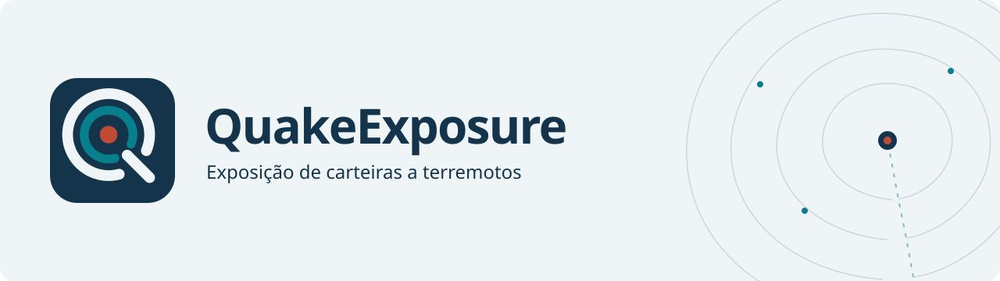
</div>

# QuakeExposure

Desenvolvi o QuakeExposure para consultar quais ativos de uma carteira entram no alcance de um terremoto e como esse resultado muda entre revisões. O mapa usa eventos e ShakeMap do USGS; os ativos e valores são fictícios. Cada resultado conserva a versão do evento, da carteira e da regra usada no cálculo.

<p>
  <a href="#demonstração"></a>
  <a href="#arquitetura"></a>
  <a href="#executar-localmente"></a>
  <a href="#verificação"></a>
  <a href="https://www.linkedin.com/in/arthur-joanes-6a2967373/"></a>
</p>

[Abrir demonstração](https://arthurjoanes.github.io/quake-exposure/) · [English](README.en.md)

[](https://github.com/arthurjoanes/quake-exposure/actions/workflows/ci.yaml)

## Visão geral

Uma revisão do terremoto ou uma correção da carteira pode mudar quais ativos entram no resultado. O QuakeExposure calcula a exposição com a versão da carteira vigente no instante do evento e conhecida na revisão escolhida. Cada publicação fixa evento, ShakeMap, versão da carteira e regra; mapa, gráficos e listas consultam esse mesmo resultado.

A carga inicial gera 10.000 ativos em duas carteiras, com valores em BRL e USD. REPLAY usa capturas reais do USGS; FAULT identifica alterações de teste; LIVE acompanha a coleta ao vivo. O painel oferece dois critérios:

| Critério | Cálculo | Leitura do resultado |
| --- | --- | --- |
| Raio de 100 km | `ST_DWithin` em geography, a partir do epicentro | Ativos próximos do evento |
| Intensidade MMI ≥ 6,0 | Amostragem do grid ShakeMap no ponto de cada ativo | Ativos dentro da extensão do grid e acima do limiar |

Os critérios selecionam ativos para consulta. Os valores representam a carteira classificada; não estimam dano, perda financeira ou terremotos futuros.

## Demonstração

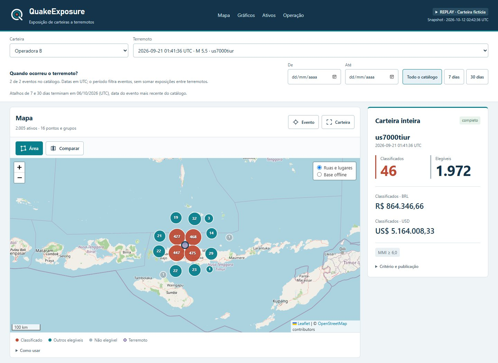

Captura local de 17/10/2026 sobre o snapshot REPLAY já versionado. [Gráficos e cobertura MMI](docs/results/product-analysis-charts.jpg) · [Celular](docs/results/product-analysis-mobile.jpg) · [Regras dos filtros e validação](docs/results/product-analysis-20261017.md).

A [demonstração online](https://arthurjoanes.github.io/quake-exposure/) abre no navegador, com capturas REPLAY e 10.000 ativos fictícios. No build local desta revisão, o período recorta o catálogo pela data do terremoto em UTC. Os atalhos de 7 e 30 dias terminam no evento mais recente disponível, inclusive em capturas antigas. O cálculo continua sendo de um evento por vez: exposições de terremotos diferentes não são somadas. Mapa, Gráficos, Ativos e Operação têm acesso direto pela navegação. No celular, os filtros ficam recolhidos. A ação Área delimita um polígono; a lista passa a mostrar seus ativos e os valores aparecem por moeda.

Comparar mostra posições anteriores e atuais, resumos e variação por moeda. A comparação considera a carteira inteira; o resultado da área permanece identificado à parte. Ver no mapa enquadra os ativos alterados. Critérios, revisões e operação ficam em controles expansíveis.

No exemplo inicial, a correção retroativa de `ope-00001` muda sua posição para um ponto com MMI 6,7. A classificação passa de 45 para 46 ativos, e o valor em USD aumenta de US$ 5.147.876,70 para US$ 5.164.008,33. O ativo vale US$ 16.131,63; o total em BRL permanece R$ 864.346,66. O grid é uma captura original; a correção pertence à carteira fictícia.

O snapshot de 11/10/2026, 23:42 em São Paulo, foi calculado pelo domínio a partir das capturas versionadas. A página pública oferece MMI e identifica que o CDC não foi executado nesse exemplo. O ambiente local também oferece raio de 100 km e o estado real do processamento. [Dados e origem](web/public/demo/snapshot.json) · [Guia de exploração](docs/exploracao.md).

<details>
<summary>Ver gráficos, ativos, comparação, operação e celular</summary>

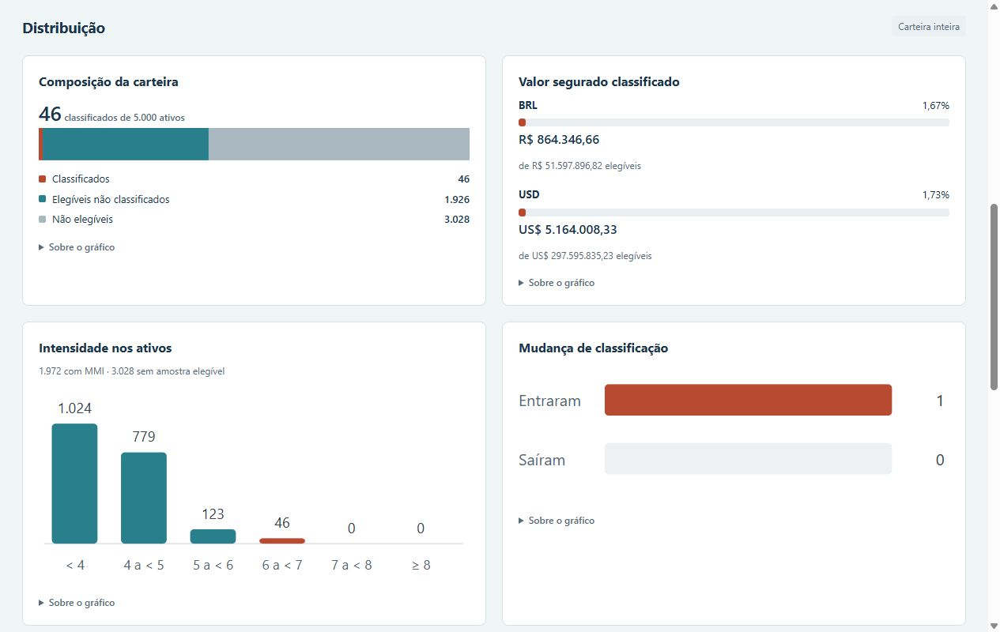

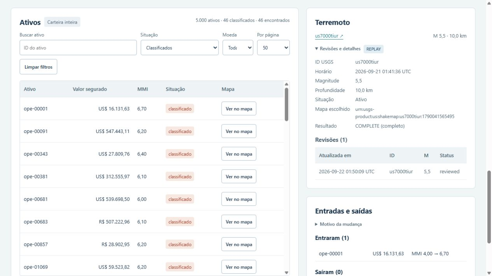

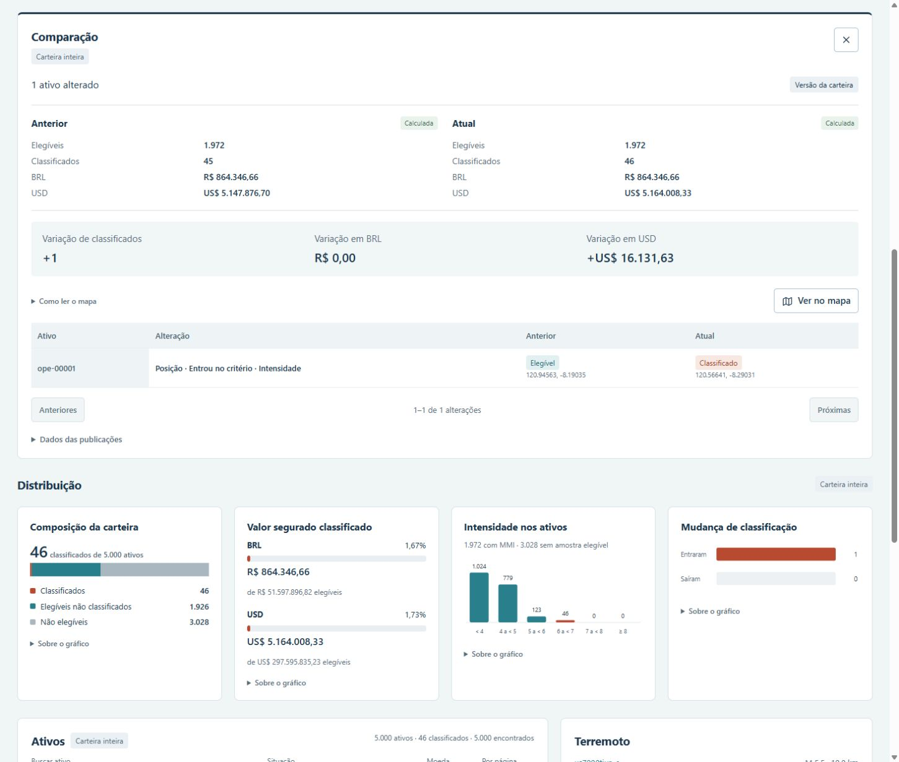

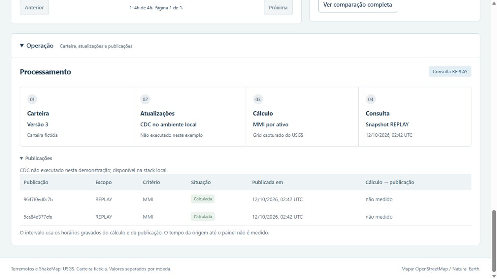

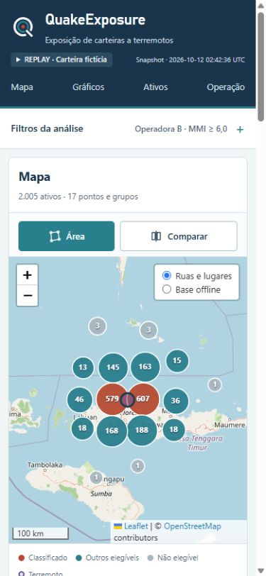

</details>

Capturas do site público em 12/10/2026, com o snapshot REPLAY descrito acima.

<details>
<summary>Capturas anteriores</summary>

[Mapa com comparação na apresentação anterior](docs/results/ui-exploration.png) · [Comparação anterior](docs/results/ui-comparison.png)

[Ativos e detalhes do evento na apresentação anterior](docs/results/ui-operations.png)

[Gráficos na apresentação anterior](docs/results/ui-map-charts.png)

[Lista e revisões na apresentação anterior](docs/results/ui-assets.png)

[Gráficos no celular](docs/results/ui-mobile-charts.png)

[Seleção por área no celular](docs/results/ui-exploration-mobile.png)

</details>

As capturas `ui-map-charts.png`, `ui-assets.png` e `ui-mobile-charts.png` são de 09/10/2026. Naquela execução local, a demo excluiu um ativo; a Operadora B ficou com 4.999, após uma carga inicial de 5.000 nessa carteira. O snapshot online usa uma carga própria e uma correção da carteira, sem executar exclusão.

Na [execução registrada em 09/10/2026](docs/results/verify-demo.json), o evento `us7000tiur`, na Operadora B e no critério MMI ≥ 6,0, produziu:

| Resultado | Valor |
| --- | --- |
| Ativos elegíveis, dentro da extensão do grid | 1.972 |
| Ativos classificados pelo limiar de intensidade | 45 |
| Valor dos classificados em BRL | R$ 864.346,66 |
| Valor dos classificados em USD | US$ 5.147.876,70 |

Para explorar o painel:

1. Selecione REPLAY, Operadora B, `us7000tiur` e o critério MMI. Confira a composição da carteira, os valores por moeda e a distribuição de intensidade nos gráficos.
2. Na lista de ativos, filtre os classificados e uma moeda. Busque um ID ou use a ação de localizar no mapa. A lista tem páginas de 50 ou 100 linhas; seus filtros não alteram os totais dos gráficos.
3. Use Área para delimitar um polígono no mapa. Arraste os vértices para ajustá-lo ou use Limpar para voltar à carteira inteira. O resultado da área fica separado do resumo geral.
4. Use Comparar para consultar a publicação anterior, posições e mudanças de classificação da carteira inteira. As alterações têm paginação; Ver no mapa enquadra os ativos da página.
5. Abra Operação pela navegação para acompanhar carteira, CDC, fila e publicações. Na demonstração pública, essa seção explica o cálculo do snapshot.

A URL guarda a seleção da análise, busca, situação, moeda e paginação da lista. Recarregar o endereço recupera esses filtros e reabre a comparação quando estava aberta. A área desenhada não é guardada. Falhas de consulta oferecem Tentar novamente; a comparação pode ser fechada durante o carregamento.

O mapa usa ruas e localidades do OpenStreetMap, com agrupamento de pontos ao afastar o zoom. A alternativa offline inclui países e costa Natural Earth em 1:50 milhões. Os tiles online precisam de internet; a carteira vem da API local. Ausência de ShakeMap aparece como indisponibilidade, sem atribuir intensidade zero aos ativos.

## Arquitetura

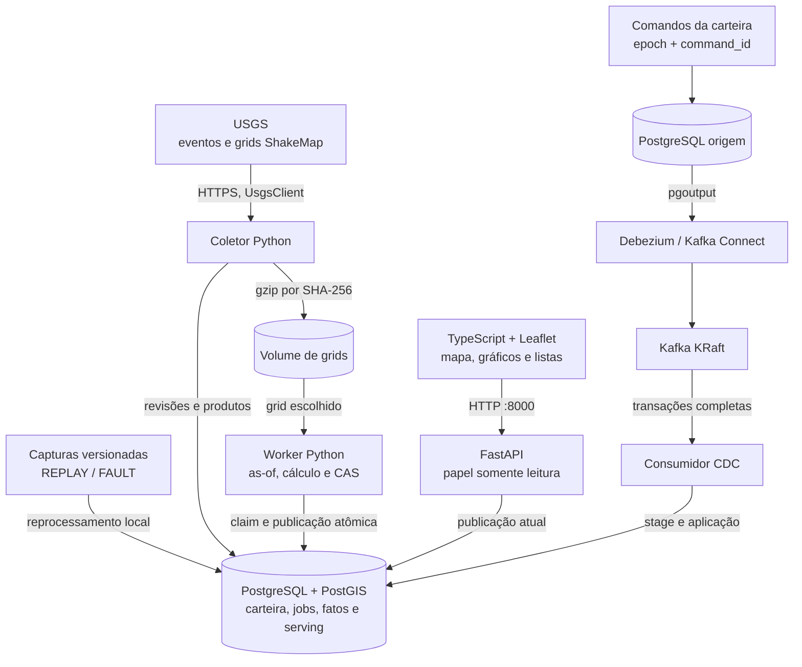

Todos os serviços do [Compose](compose.yaml) rodam no mesmo host. A API serve a página e consulta a publicação atual; o navegador não acessa bancos nem Kafka. O coletor ao vivo é opcional para a demo com capturas.

| Responsabilidade | Implementação e decisão |
| --- | --- |
| Revisões e identidade | [Domínio](src/quakeexposure/domain/) e [ingestão](src/quakeexposure/ingestion/): hashes canônicos, aliases atuais, duplicatas sem efeito e conflitos em quarentena. |
| Carteira histórica | [Origem](src/quakeexposure/portfolio/source.py) e [CDC](src/quakeexposure/cdc/): comandos idempotentes, epoch por tenant e aplicação de transações completas. [ADR](docs/adr/0002-kafka-na-carteira.md). |
| Publicação consistente | [Worker](src/quakeexposure/exposure/worker.py): fatos, totais e ponteiro atual na mesma transação; uma geração antiga não publica. [ADR](docs/adr/0003-calculo-e-cas.md). |
| Exclusão e restauração | [Privacidade](src/quakeexposure/privacy/): ledger em volume separado, sanitização de CDC antigo e reaplicação dos bloqueios ao restaurar. [ADR](docs/adr/0004-exclusao-contra-replay.md). |
| Exploração e operação | [Interface](web/src/) e [API](src/quakeexposure/api/): consulta regional limitada, seleção por polígono, comparação paginada e estado do processamento. Respostas antigas são descartadas; moedas mantêm valores inteiros. [ADR](docs/adr/0005-exploracao-e-demo.md). |

## Stack e decisões

<p>
  
  
  
  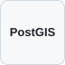
  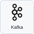
  
  
  
  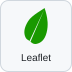
  
</p>

| Componente | Papel e compromisso |
| --- | --- |
| Python 3.14, uv e FastAPI | Domínio, coleta, cálculo e API; processos separados compartilham o código. |
| PostgreSQL + PostGIS | Histórico, cálculo geográfico e publicação transacional; o banco concentra essas responsabilidades. |
| Debezium e Kafka | Transporte das mudanças da carteira; exigem operação do slot, offsets e stage. |
| TypeScript, Vite e Leaflet | Interface com Canvas, agrupamento de pontos e gráficos SVG; sem biblioteca adicional de gráficos. |
| Docker Compose | Ambiente local com volumes nomeados; todos os serviços dependem do mesmo host. |

Versões fixadas em [uv.lock](uv.lock), [package-lock.json](web/package-lock.json) e [Compose](compose.yaml). Decisões em [docs/adr](docs/adr/).

## Executar localmente

Requer Docker Desktop/Compose e uv. Node.js é necessário para desenvolver a página fora do build Docker. O uv instala o Python 3.14 fixado no projeto. No Windows, `python -m uv` funciona quando `uv` não está no PATH.

```bash
uv sync --frozen
uv run qe secrets
docker compose up -d --build cdc
docker compose run --rm --no-deps worker qe bootstrap
docker compose up -d worker api
```

Abra [127.0.0.1:8000](http://127.0.0.1:8000). A seleção inicial usa REPLAY e o evento `us7000tiur`. O bootstrap aguarda o CDC, carrega a carteira pela origem e importa as capturas versionadas, sem consultar o USGS. Uma carga completa pode ser retomada; uma carga parcial exige o [reset manual do runbook](docs/operacao.md#slot-perdido-ou-offsets-expirados).

```bash
docker compose exec worker qe demo
docker compose exec worker qe status --json
```

A demo percorre cinco passos: replay real, revisão FAULT e duplicata, correção da carteira via CDC, recusa de um cálculo antigo e exclusão seguida de reentrega CDC. Cada execução altera a carteira fictícia e exclui um ativo.

O [guia de operação](docs/operacao.md) contém os comandos de coleta ao vivo, correção da carteira, exclusão, backup e restauração. Também explica como registrar a demo com commit e asserções. Grids opcionais de redes diferentes de `us` são baixados separadamente, com conferência de hashes.

Para gerar a demonstração estática a partir das capturas, consulte [Exportar a demonstração](docs/operacao.md#exportar-a-demonstração). A publicação no GitHub Pages usa o [workflow REPLAY](.github/workflows/pages.yaml).

## Verificação

| Registro | Resultado e alcance |
| --- | --- |
| [Demo dos cinco passos](docs/results/verify-demo.json) | Oito asserções em 09/10/2026, incluindo duplicata, CDC as-of, geração antiga recusada e reentrega após exclusão. |
| [Restauração](docs/results/restore-verification.json) | Ledger reaplicado, titular ausente e acesso negado ao papel da API no banco restaurado. |
| [Bootstrap com volumes vazios](docs/results/m6-bootstrap-cold.md) | 356,907 s até as quatro publicações principais, com imagens em cache e carga concorrente descrita no registro. |
| [Testes e verificações](docs/progress.md) | Fechamento do M6: 307 testes Python sem skips. Melhoria da interface: 80 testes de frontend, typecheck e build. |
| [CI de 09/10/2026](https://github.com/arthurjoanes/quake-exposure/actions/runs/38004551496) | Cinco jobs concluídos no commit `7564a7c`: Python, frontend, PostGIS, integração e segurança. |
| [Snapshot REPLAY](web/public/demo/snapshot.json) | Origem, seed, hashes e cenário da página pública. [Regressões do exportador](tests/unit/test_public_demo.py) conferem os valores do exemplo. |
| [CI da exploração](https://github.com/arthurjoanes/quake-exposure/actions/runs/38197953583) | Commit `cb359c2`: Python, frontend, PostGIS, integração e segurança aprovados. 259 testes locais de unidade/propriedade e 110 da interface; testes da stack executados no CI. |
| [Revisão de UI/UX](docs/progress.md) | 129 testes de frontend executados localmente em 12/10/2026, incluindo estado da navegação, comparação, operação e filtros da lista. |

Para repetir as verificações:

```bash
uv run ruff check .
uv run ruff format --check .
uv run mypy
uv run pytest
cd web
npm ci
npm test
npm run typecheck
npm run build
```

Os testes usam apenas a rede local. Integrações sobem bancos, Kafka e Debezium reais em projetos descartáveis; sem Docker, são puladas. O [workflow](.github/workflows/ci.yaml) inclui unitários, propriedades, contratos, PostGIS como service, integração completa, frontend, gitleaks, pip-audit e npm audit. Os registros acima descrevem execuções identificadas; o badge consulta o estado atual do workflow. O tempo de bootstrap é uma medição local com imagens em cache, sem incluir download ou build.

<a id="limitações"></a>

## Limites e segurança

- Carteira fictícia, BRL e USD sem conversão. Valores monetários são inteiros e strings no JSON; não se somam carteiras entre terremotos.
- Polling registra as revisões observadas, não todas as revisões intermediárias do USGS.
- LIVE calcula eventos com ShakeMap dos últimos sete dias e watchlist. REPLAY e FAULT são separados e rotulados.
- API somente leitura, sem autenticação; tenant é filtro. Apenas a porta 8000 é publicada, em 127.0.0.1. Sem TLS entre containers.
- Slot perdido, offset expirado ou seed parcial exigem reset manual. Não há alta disponibilidade.
- Kafka pode manter mensagens por sete dias; WAL e dumps têm resíduos descritos no recibo. A restauração reaplica o ledger atual, guardado fora do volume dos bancos.
- A exclusão invalida publicações do tenant até o recálculo. Dados de um titular bloqueado não voltam ao cálculo por CDC antigo.

## Documentação

| Para consultar | Referência |
| --- | --- |
| Instalação, operação e recuperação | [Runbook](docs/operacao.md) |
| Seleção por área, comparação e processamento | [Guia de exploração](docs/exploracao.md) |
| Escolhas de implementação | [ADRs](docs/adr/) · [Regras do repositório](CONTRIBUTING.md) |
| Execuções e medições | [Resultados](docs/results/) · [Progresso por milestone](docs/progress.md) |
| Identidade visual | [Símbolo](web/public/brand/quake-exposure-mark.svg) · [Logotipo](web/public/brand/wordmark.svg) · [Banner](docs/assets/banner.svg) |
| Manter a apresentação | [Padrão documental](docs/padrao-documentacao.md) · [Fontes e licença dos ícones](docs/stack/README.md) |
| Referências das melhorias | [Projetos e adaptações](docs/referencias.md) |

<a id="autor-dados-e-licença"></a>

## Autor e licença

<p><a href="https://www.linkedin.com/in/arthur-joanes-6a2967373/"> <strong>Arthur Joanes no LinkedIn</strong></a></p>

[GitHub](https://github.com/arthurjoanes) · [Relatar um problema](https://github.com/arthurjoanes/quake-exposure/issues).

Código e marca própria sob [MIT](LICENSE). Dados do U.S. Geological Survey, domínio público; ComCat DOI 10.5066/F7MS3QZH. Mapa online © OpenStreetMap contributors; base offline Natural Earth via world-atlas. Fontes e créditos em [NOTICE](NOTICE).

Ícones Devicon, Simple Icons e cartões com os nomes das tecnologias: [fontes e licenças](docs/stack/README.md).
